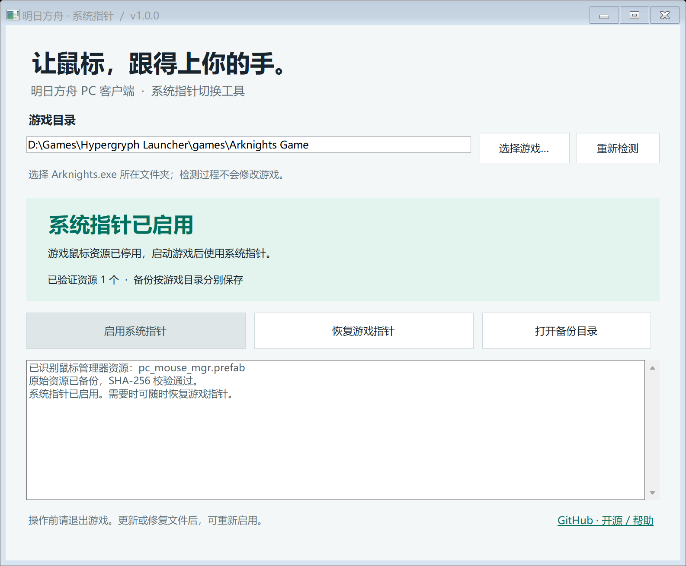

# 明日方舟 · 系统指针

让 loading 时的鼠标也能跟得上你的手。

明日方舟 PC 客户端的游戏指针可能随掉帧而卡顿。这个小工具临时停用独立的鼠标管理器资源，让游戏保留系统指针，并提供备份和恢复。**已在国服 PC 客户端实测有效；其他客户端和后续版本需要验证。**

[下载最新版本](https://github.com/assfafa/arknights-system-cursor/releases/latest) · [给 AI 助手的操作说明](docs/AI-ASSISTANTS.md) · [原理与兼容性](docs/HOW-IT-WORKS.md)



## 使用

1. 完全退出明日方舟。
2. 在 Release 下载 `ArknightsSystemCursor.exe`，双击运行。也可以下载便携 ZIP，其中另有命令行工具。
3. 点击「选择游戏」，选中客户端的 `Arknights.exe`。
4. 点击「启用系统指针」，再正常启动游戏。

需要恢复时，退出游戏，打开工具，点击「恢复游戏指针」。之前手动加了 `.disabled-by-codex` 后缀的资源也可以识别和恢复。

Windows 10 / 11，需 .NET Framework 4.8；Windows 11 和较新的 Windows 10 通常已包含。用户无需安装 Python、.NET SDK 或额外的拆包工具。[微软安装说明](https://learn.microsoft.com/en-us/dotnet/framework/install/)

## 它会做什么

- 读取并验证资源包内容，确认包含 `dyn/mouse/pc_mouse_mgr.prefab`。
- 同时检查安装资源和热更新资源目录，支持匿名 `.bin` 包。
- 创建独立备份，记录 SHA-256，再给原文件加停用后缀。
- 恢复前检查文件内容和 SHA-256；保留游戏更新或修复后生成的新原文件。
- 检测客户端进程，游戏运行时阻止修改。

工具只改名已经识别的鼠标资源。不修改游戏 EXE、DLL、注册表或资源索引，也不注入游戏进程。仓库和下载包**不包含任何游戏原始资源**。

备份位于：

```text
%LOCALAPPDATA%\ArknightsSystemCursor\installations\<游戏目录标识>\
  manifest.json
  backups\<SHA-256>.bin
```

原目录下也会保留带 `.system-cursor-disabled-<校验值前缀>` 后缀的资源。请保留这些文件，直到不再需要恢复。

## 更新与异常

- **更新/修复游戏后又变回游戏指针：**重新检测，再次启用。工具会备份新的资源版本。
- **游戏报资源错误、无法加载或指针消失：**退出游戏后恢复游戏指针。当前版本可能不支持此方法。
- **没有识别到鼠标资源：**工具会停止操作。请提交游戏版本和现象，勿上传游戏资源、账号信息或备份文件。
- **访问被拒绝：**检查目录权限；如果游戏安装在受保护目录，可按实际需要以管理员身份运行。
- **SmartScreen 提示未知发布者：**此项目暂未购买代码签名证书。请核对下载来源和 Release 的 SHA-256。

这是非官方工具，与鹰角网络无关联。修改资源可能被启动器的文件校验还原；不承诺所有游戏版本或反作弊策略下都可用。

## 命令行 / AI 助手

便携 ZIP 包中的 `ArknightsSystemCursor.Cli.exe` 输出 JSON，退出码 `0` 表示成功，`1` 表示失败。

```powershell
$GameDir = 'D:\Games\Hypergryph Launcher\games\Arknights Game'
.\ArknightsSystemCursor.Cli.exe status  --game-dir $GameDir --json
.\ArknightsSystemCursor.Cli.exe enable  --game-dir $GameDir --json
.\ArknightsSystemCursor.Cli.exe restore --game-dir $GameDir --json
```

Codex、Claude、豆包及其他助手可直接阅读 [AI-ASSISTANTS.md](docs/AI-ASSISTANTS.md)。助手需要具有本机文件和命令执行能力；普通网页聊天可以依照文档指导用户操作。

## 从源码构建

Windows，安装 .NET 8 SDK 或兼容的更新 SDK：

```powershell
.\scripts\build.ps1
```

脚本会编译 GUI 和 CLI、运行合成资源测试，并在 `artifacts/` 生成便携 ZIP、独立 EXE 和 SHA-256。首次构建从 NuGet 下载 .NET Framework 参考程序集；成品使用 Windows 的 .NET Framework 运行。

```powershell
dotnet build tests/ArknightsSystemCursor.Tests.csproj -c Release
.\tests\bin\Release\net48\ArknightsSystemCursor.Tests.exe
```

测试使用人工生成的微型 UnityFS 数据，覆盖压缩解码、备份恢复、损坏文件、游戏更新、并发和路径校验，不需要游戏安装。GitHub Actions 自动执行相同构建流程。

## 致谢与许可

资源格式研究参考了 [UnityPy](https://github.com/K0lb3/UnityPy) 和 [MooncellWiki 对明日方舟压缩变体的说明](https://github.com/MooncellWiki/UnityPy/commit/781badde6d636f101279fef76f461bb8dd0e1ffc)。本项目使用独立实现的只读 C# 解码器，不依赖或捆绑这些项目。

本工具源码采用 [MIT License](LICENSE)。明日方舟及其资源属于相应权利人。
